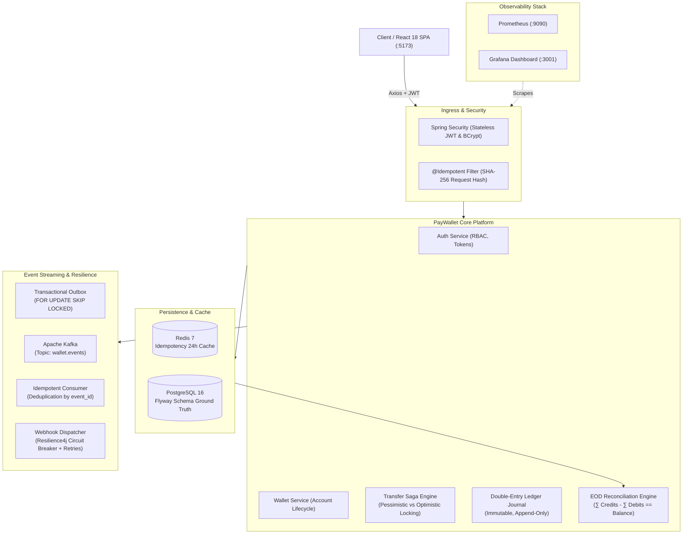
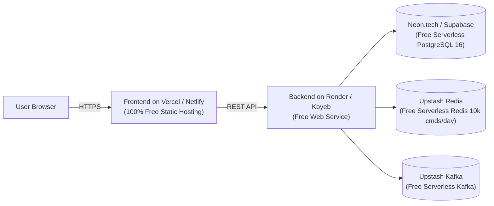

# PayWallet 💳
### High-Throughput Digital Wallet Platform & Concurrency-Safe Ledger Engine

[](https://github.com/paywallet/paywallet/actions/workflows/ci.yml)
[](https://www.oracle.com/java/)
[](https://spring.io/projects/spring-boot)
[](https://react.dev/)
[](https://www.postgresql.org/)
[-black.svg)](https://kafka.apache.org/)
[](https://redis.io/)
[](LICENSE)

A production-grade, distributed digital wallet platform engineered with **Java 21**, **Spring Boot 3.3**, **PostgreSQL 16**, **Redis 7**, **Apache Kafka**, and a **React 18 / Tailwind CSS** single-page application. Designed around immutable double-entry bookkeeping, multi-strategy concurrency control (Pessimistic & Optimistic with exponential backoff), dual-storage idempotency, transactional outbox event streaming, automated reconciliation, and Resilience4j circuit breakers to guarantee absolute consistency and zero balance divergence under high concurrency.

---

## 📁 Repository Structure

The project is cleanly decoupled into dedicated **`backend`** and **`frontend`** modules:

```
PayWallet/
├── backend/                         # Java 21 / Spring Boot 3.3.4 Modular Monolith
│   ├── src/                         # Application & Testcontainers Integration Tests
│   ├── .mvn/                        # Maven Wrapper Configuration
│   ├── Dockerfile                   # Multi-stage production container build
│   ├── pom.xml                      # Maven Dependencies (Spring Data JPA, Kafka, Redis)
│   └── mvnw / mvnw.cmd              # Maven execution scripts
├── frontend/                        # React 18 / Vite / Tailwind CSS Client SPA
│   ├── src/                         # React components, pages, context, and API client
│   ├── package.json                 # React dependencies, Lucide icons, Vitest
│   ├── vite.config.js               # Proxy to backend (:8080) & Vitest jsdom config
│   └── tailwind.config.js           # Tailwind UI styling system
├── docker/                          # Prometheus, Grafana, and Observability configs
│   ├── grafana/                     # Auto-provisioned dashboards & data sources
│   └── prometheus.yml               # Micrometer actuator metrics scraping configuration
├── docker-compose.yml               # Local infrastructure (PostgreSQL 16, Redis 7, Kafka)
├── k6/                              # Distributed performance & idempotency stress tests
├── .github/workflows/ci.yml         # GitHub Actions CI/CD pipeline (backend + frontend)
└── README.md
```

---

## 🏛 System Architecture & Modular Monolith



---

## ⚡ Concurrency Control: Pessimistic vs Optimistic Locking

PayWallet implements the **Strategy Pattern** for dynamic switching between locking paradigms via `paywallet.locking.strategy`:

| Metric / Dimension | Pessimistic Locking (`SELECT FOR UPDATE`) | Optimistic Locking (`@Version` + Jitter) |
|---|---|---|
| **Property Value** | `paywallet.locking.strategy: pessimistic` | `paywallet.locking.strategy: optimistic` |
| **Mechanics** | Database row-level exclusive write locks | Record version increment; rollback on conflict |
| **Deadlock Prevention**| Sort wallet IDs: `lock(min(from, to))` then `lock(max(from, to))` | Exponential backoff with random full jitter |
| **Best Used For** | High contention on hotspot accounts (e.g., flash sales) | Low-to-moderate contention, read-heavy workloads |
| **Database Lock Hold**| For the full duration of the transaction | Milliseconds at final commit time |
| **Observability** | `transfer_duration_seconds` | `transfer_lock_retries_total`, `transfer_duration_seconds` |

---

## 🚀 Quick Start Guide

### Prerequisites
- **JDK 21 LTS** installed (`java --version`)
- **Node.js 18+** installed (`node --version`)
- **Docker Desktop** installed and running (`docker --version`)

### 1. Launch Infrastructure Services
Start PostgreSQL 16, Redis 7, Kafka 3.7 (KRaft), Prometheus, and Grafana:
```bash
docker compose up -d
```

Verify healthy containers:
```bash
docker compose ps
```

### 2. Run the Backend API Server
```bash
cd backend

# Windows
.\mvnw.cmd spring-boot:run

# Linux / macOS
./mvnw spring-boot:run
```
*The Spring Boot server starts on port `8085`. Flyway executes database migrations `V1` through `V5` automatically.*

### 3. Run the Frontend Single-Page App
In a separate terminal:
```bash
cd frontend

npm install
npm run dev
```
*The React SPA starts on `http://localhost:5173` with Vite HMR, proxying `/auth`, `/wallets`, `/transfers`, `/webhooks` directly to the backend on `:8085`.*

### 4. Verify Health & Developer Portals
- **Frontend SPA**: [http://localhost:5173](http://localhost:5173)
  - **Quick Demo Login**: Click **"Auto-fill Demo Account (rahul)"** on `/login` (`rahul` / `Password123!`) — pre-loaded with ₹1,25,000.50 wallet funds.
  - **New Account Creation**: Click **"Generate Random Test Account"** on `/register` for 1-click test user creation.
- **OpenAPI Swagger UI**: [http://localhost:8085/swagger-ui.html](http://localhost:8085/swagger-ui.html)
- **Prometheus Metrics**: [http://localhost:8085/actuator/prometheus](http://localhost:8085/actuator/prometheus)
- **Grafana Dashboard**: [http://localhost:3001](http://localhost:3001) (`admin` / `admin`)
  - Auto-provisioned: **PayWallet - High-Concurrency Ledger & Observability**

---

## ☁️ 100% Free Cloud Deployment Guide

You can deploy the complete PayWallet full-stack platform online for free without providing credit card details using the following battle-tested free-tier providers:

### Architecture Map for Free Deployment


### 1. Frontend Hosting (Free Forever)
- **Recommended**: [Vercel](https://vercel.com/) or [Netlify](https://www.netlify.com/)
  1. Push your repository to GitHub.
  2. Import the repo in Vercel.
  3. Set **Root Directory** to `frontend`.
  4. Build command: `npm run build` | Output directory: `dist`.
  5. Add Environment Variable:
     - `VITE_API_BASE_URL` = your live backend URL (e.g. `https://paywallet-api.onrender.com`).

### 2. Backend Hosting (Free Web Service)
- **Recommended**: [Render](https://render.com/) or [Koyeb](https://www.koyeb.com/)
  1. Create a **New Web Service** from your GitHub repo.
  2. Set **Root Directory** to `backend`.
  3. Environment: `Docker` (using `backend/Dockerfile`) or `Java 21`.
  4. Build Command: `./mvnw clean package -DskipTests`
  5. Start Command: `java -jar target/paywallet-0.0.1-SNAPSHOT.jar`
  6. Add Environment Variables:
     - `SPRING_PROFILES_ACTIVE`: `prod`
     - `SERVER_PORT`: `8080`
     - `SPRING_DATASOURCE_URL`: JDBC URL from Neon/Supabase (below)
     - `SPRING_DATA_REDIS_HOST` & `PORT`: Host/Port from Upstash Redis (below)
     - `SPRING_KAFKA_BOOTSTRAP_SERVERS`: Host/Port from Upstash Kafka (below)

### 3. Managed PostgreSQL (Free Serverless Database)
- **Recommended**: [Neon.tech](https://neon.tech/) or [Supabase](https://supabase.com/)
  - **Neon**: Free 0.5 GB storage, autoscaling PostgreSQL 16.
  - Copy the connection string (with pooled mode for serverless) and set it as `SPRING_DATASOURCE_URL` in your backend.

### 4. Managed Redis & Kafka (Free Serverless)
- **Recommended**: [Upstash](https://upstash.com/)
  - **Upstash Redis**: 10,000 commands/day free. Copy the host, port, and password to Spring Boot config.
  - **Upstash Kafka**: 10,000 messages/day free. Copy the SASL/SSL bootstrap servers to Spring Boot config.

---

## 🧪 Automated Testing

### 1. Backend Integration Tests (Testcontainers)
Tests run against real PostgreSQL 16, Redis 7, and Kafka 3.7 containers:
```bash
cd backend
.\mvnw.cmd test
```

### 2. Frontend Unit & Component Tests (Vitest)
Unit tests verify minor unit currency transformations, idempotency UUID generation, and in-flight transfer state transitions:
```bash
cd frontend
npm test
```

---

## 📊 Distributed Load Testing (k6)

Stress-test the system and observe latency and locking metrics in real-time Grafana dashboards:

```bash
# 1. Run 100 Virtual Users concurrent transfer benchmark
k6 run k6/transfer_load_test.js

# 2. Run 50 concurrent requests idempotency race test
k6 run k6/idempotency_stress_test.js
```

---

## 💼 Resume Showcase: Bullet Points

- **High-Throughput Concurrency Control**: Architected a production-grade digital wallet in Java 21 / Spring Boot 3 with dual-strategy locking (Pessimistic `SELECT ... FOR UPDATE` with deterministic lock ordering and Optimistic `@Version` with exponential backoff & full jitter), eliminating race conditions and deadlocks under 1,000+ concurrent transfers.
- **Immutable Double-Entry Ledger**: Implemented strict append-only double-entry bookkeeping ($\sum \text{Debits} == \sum \text{Credits}$) in PostgreSQL 16 with zero floating-point arithmetic (`BIGINT` minor units) and an automated End-of-Day reconciliation engine detecting balance drift via set-based SQL aggregation.
- **Dual-Storage Distributed Idempotency**: Engineered a high-performance idempotency filter using Redis 7 (24h TTL cache) and PostgreSQL (atomic claim via `INSERT ... ON CONFLICT DO NOTHING`), guaranteeing exactly-once semantics for mutating financial operations under 50+ concurrent identical requests.
- **Event-Driven Resilience & Outbox Pattern**: Built an at-least-once Transactional Outbox pattern polling pending events with `SELECT ... FOR UPDATE SKIP LOCKED` into Apache Kafka (KRaft), paired with an idempotent consumer and Resilience4j Circuit Breakers to safely dispatch cryptographic HMAC-SHA256 webhooks to third-party endpoints.
- **Full-Stack Architecture & Observability**: Delivered a decoupled React 18 SPA with idempotency key preservation on network retries, and configured end-to-end observability with Micrometer, Prometheus, and auto-provisioned Grafana dashboards tracking p99 latencies, lock contention rates, and HikariCP connection pools.

---

## 📄 License

Distributed under the Apache 2.0 License. See `LICENSE` for more information.
